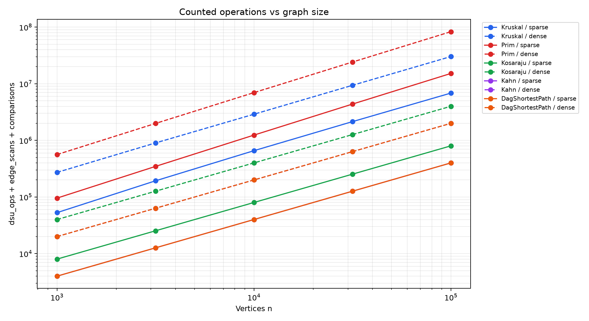
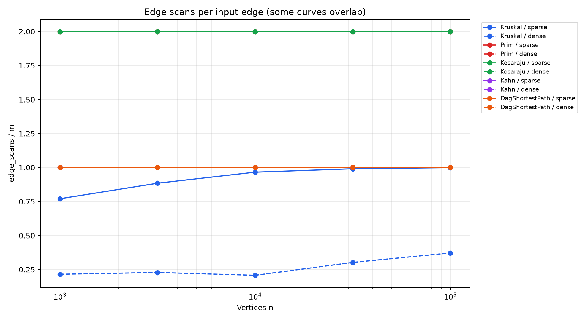
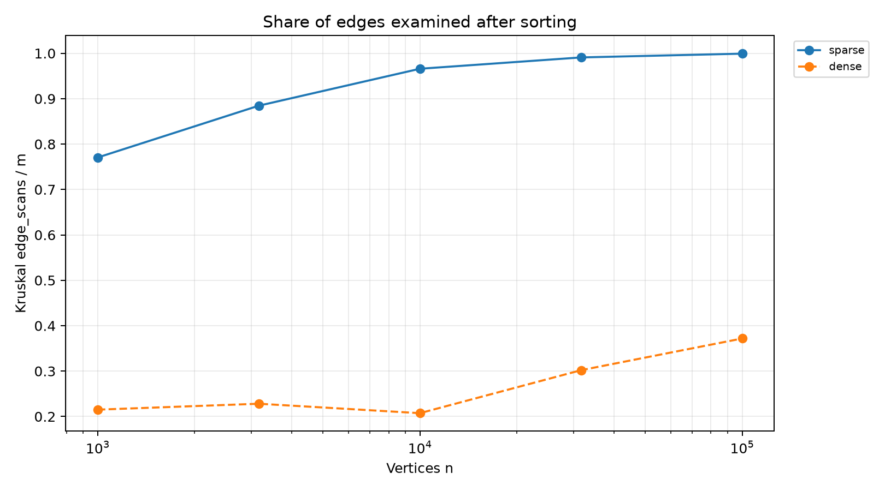

# Assignment 3: Graph Algorithms Report

## 1. Implementation and validation

The project implements DSU, Kruskal, Prim, Kosaraju, Kahn and
shortest paths in a DAG. One adjacency-list Graph class supports
directed and undirected graphs, integer weights, parallel edges,
self-loops and isolated vertices.

DSU uses union by size and iterative path compression.
Kruskal and Prim return a minimum spanning forest when the graph
is disconnected. Kosaraju uses explicit stacks instead of recursion.
Kahn reports a cycle instead of returning an incomplete order.

All 20 JUnit tests passed. Tests include 100 random connected
graphs for MST agreement, SCC comparisons against BFS reachability,
100 random DAG comparisons against Bellman-Ford, negative weights,
and an SCC traversal of a path containing 100,000 vertices.

The benchmark uses five sizes: 1,000, 3,162, 10,000, 31,623 and
100,000 vertices. Each size has m = 4n and m = 20n.
The labels sparse and dense describe relative density here:
both families have E proportional to V.

Each graph kind starts with a new Random(42).
All ten reference cases passed, including MST weights,
SCC counts and sums of DAG distances.
The CSV contains 50 algorithm-case rows.

## 2. Complexity

V is the number of vertices and E is the number of input edges.
Space excludes the input graph but includes working structures
and returned results.

| Operation | Time | Extra space | Justification |
|---|---|---|---|
| DSU initialization | O(V) | O(V) | Initializes parent and size arrays. |
| DSU find / union | O(alpha(V)) amortized | O(1) per operation | Union by size and path compression keep parent paths short; the DSU structure itself occupies O(V). |
| Kruskal | O(V + E log(E + 1)) | O(V + E) | Initializes DSU, copies and sorts edges, then checks candidates. |
| Prim | O(V + E log(E + 1)) | O(V + E) | This lazy implementation stores candidate edges in a priority queue, including obsolete candidates. |
| Kosaraju | O(V + E) | O(V + E) | Two traversals, an explicit stack and a reversed graph. |
| Kahn | O(V + E) | O(V) | Computes in-degrees and processes vertices using a queue. |
| DAG shortest paths | O(V + E) | O(V) | Computes a topological order, initializes sources and relaxes each edge once. |

For simple connected graphs, the usual O(E log V) expression
also describes this Prim implementation because E <= V squared.
The E-based expression is safer for graphs with parallel edges.

## 3. Counter definitions

Counters are updated inside the algorithms.

- dsu_ops counts find calls plus successful unions.
- edge_scans counts edges examined during the main traversal
  or the candidate-selection stage.
- comparisons counts weight comparisons during sorting or
  priority-queue operations.
- max_depth records the maximum explicit-stack occupancy.

For Kosaraju, edge_scans excludes construction of the reversed
graph. For Kahn, it excludes initial in-degree calculation.
For DAG shortest paths, it counts the relaxation pass; the
preliminary Kahn run uses separate metrics.

Therefore Kosaraju records exactly 2E scans, while Kahn and DAG
relaxation record E scans on the generated DAGs.
These conventions do not remove preprocessing from runtime.

The operations plot uses dsu_ops + edge_scans + comparisons.
This is a selected-work indicator, not a count of every machine
instruction. In particular, find calls do not count internal
parent-pointer visits, so they cannot independently demonstrate
the alpha(V) amortized bound.

## 4. Counters compared with formulas

Ranges below cover the five sizes within each density.

| Algorithm | Density | Counter / formula | Minimum | Maximum |
|---|---|---|---:|---:|
| Kruskal | sparse | comparisons / (E log2 E) | 0.7447 | 0.9069 |
| Kruskal | dense | comparisons / (E log2 E) | 0.6662 | 0.9027 |
| Prim | sparse | comparisons / (E log2 E) | 1.8291 | 1.9344 |
| Prim | dense | comparisons / (E log2 E) | 1.8248 | 1.8896 |
| Kosaraju | sparse | edge_scans / (V + E) | 1.6000 | 1.6000 |
| Kosaraju | dense | edge_scans / (V + E) | 1.9048 | 1.9048 |
| Kahn | sparse | edge_scans / (V + E) | 0.8000 | 0.8000 |
| Kahn | dense | edge_scans / (V + E) | 0.9524 | 0.9524 |
| DAG shortest paths | sparse | edge_scans / (V + E) | 0.8000 | 0.8000 |
| DAG shortest paths | dense | edge_scans / (V + E) | 0.9524 | 0.9524 |

Kruskal's dsu_ops / E ranges from 1.7908 to 2.2483 for sparse
graphs and from 0.4647 to 0.7936 for dense graphs.
These values vary because the algorithm stops once the graph
has one component.

The traversal ratios are exactly constant at each density,
matching linear work. Prim's normalized comparison counts are
also relatively stable. Kruskal's comparison ratios vary more:
sorting behaviour depends on the input and its repeated integer
weights. These finite measurements support the complexity
analysis but do not prove an asymptotic bound.

## 5. Correctness arguments

### Cut property and minimum spanning trees

Consider a cut separating vertices into two sets and a
minimum-weight edge crossing that cut.
If an MST does not contain this edge, adding it creates a cycle.
That cycle contains another edge crossing the same cut.
Replacing that crossing edge with the chosen minimum-weight edge
does not increase the total weight.
Thus, a minimum-weight crossing edge is safe when the cut respects
the edges already selected.
Kruskal applies this reasoning to DSU components, while Prim
applies it to the visited set and the remaining vertices.

### Induction on a topological order

A topological order places every predecessor before its successor.
Every vertex with in-degree zero starts at distance zero,
representing an edge from a virtual super-source.
Assume all vertices preceding the current vertex have already
received their correct shortest distances.
Every path into the current vertex ends with an edge from one
of those earlier vertices, and that edge has already been relaxed.
Its distance is therefore correct, so relaxing its outgoing edges
preserves the induction.
After the final vertex, all distances are correct, and parent
links restore paths that achieve them.

### Negative weights

Negative edges are safe in a DAG because there are no directed
cycles and no later edge can lead back to an earlier vertex.
In a general directed graph, negative edges require an algorithm
such as Bellman-Ford rather than ordinary Dijkstra.
A reachable negative cycle can make shortest distances unbounded
below, so finite shortest paths may not exist.

## 6. Which algorithm when?

| Situation | Choice | Reason |
|---|---|---|
| Undirected graph already stored as an edge list | Kruskal | Sorting and DSU directly use the edge list. |
| Sparse undirected graph stored as adjacency lists | Prim or Kruskal | Both are suitable; compare queue and sorting work for the workload. |
| Very dense simple undirected graph | Consider array-based Prim | An O(V squared) version can avoid heap overhead; it is not implemented here. |
| Disconnected undirected graph | Kruskal or component-aware Prim | Both implemented versions return a minimum spanning forest. |
| Directed graph where cycles may occur | Kosaraju | Finds strongly connected groups and helps identify cyclic dependencies. |
| Dependency ordering with cycle detection | Kahn | Produces a valid order or reports a cycle. |
| Shortest paths in a DAG, including negative edges | DAG relaxation | One relaxation pass after topological sorting. |
| General directed graph with negative edges | Bellman-Ford | Handles negative edges and can detect reachable negative cycles. |

## 7. Plots and slopes

### Counted operations

### Scans per input edge

### Fraction of edges examined by Kruskal

Slopes were fitted by least squares to log(counter) against log(n),
separately for each density.

| Algorithm | Density | Scan slope | Operations slope | Comparison slope |
|---|---|---:|---:|---:|
| Kruskal | sparse | 1.0550 | 1.0537 | 1.0545 |
| Kruskal | dense | 1.1194 | 1.0219 | 1.0159 |
| Prim | sparse | 1.0000 | 1.1007 | 1.1079 |
| Prim | dense | 1.0000 | 1.0850 | 1.0903 |
| Kosaraju | both | 1.0000 | 1.0000 | N/A |
| Kahn | both | 1.0000 | 1.0000 | N/A |
| DAG shortest paths | both | 1.0000 | 1.0000 | N/A |

The traversal slopes are exactly 1.0000, as expected when E is
proportional to V. Prim scans each undirected adjacency entry,
so its scan curve is linear; its queue comparisons grow faster.

Kruskal's scan slope reflects candidate examination and early
termination. Sorting's logarithmic factor belongs to the comparison
counter, not the scan counter. The measured comparison slopes are
finite-range observations and need not match an idealized
E log E curve exactly.

For sparse graphs, Kruskal examined 77.05% to 99.92% of input edges.
For dense graphs, it examined 20.74% to 37.18%.
It still sorted all edges before examining this fraction.
Prim scans the adjacency entries of all vertices, so it cannot
obtain the same scan reduction, although it avoids global sorting.

Kosaraju's maximum observed stack occupancy was 91,920.
The separate 100,000-vertex path test reached a depth of 100,000
without using the JVM call stack.

## 8. Wall-clock time

Times are medians of five runs per algorithm-case.
Observed ranges were 2.076–456.711 ms for Kruskal,
3.258–1282.475 ms for Prim, 1.360–264.478 ms for Kosaraju,
0.455–56.445 ms for Kahn and 1.006–113.309 ms for DAG shortest
paths. These are ranges across different sizes and densities,
not paired speedup measurements. There was no separate warm-up
phase. JIT compilation, garbage collection, hardware and background
load can affect runtime, especially for small graphs. Therefore,
operation counters and correctness checks are the main evidence;
these times do not establish a universal algorithm ranking.